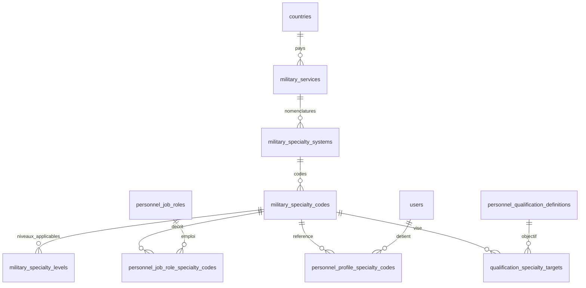

# Spécialités militaires — audit, schéma validé et intégration

**Date : 17 novembre 2026. Statut : SCHÉMA VALIDÉ, IMPLÉMENTÉ DANS LE DÉPÔT.**

Le schéma ci-dessous a été validé par l’utilisateur avant l’écriture PHP/SQL. L’étape
`4910_military_specialty_codes.php` crée les six tables et charge le catalogue documenté.
La migration a été testée sur des bases jetables ; elle n’a pas été exécutée en production.

## 1. Audit de l’existant

Audit du dépôt `/workspace/COMSPEC-MILSIM`, dont `CLAUDE.md`, `database/`, `migrations/`,
les composants RH/LMS de `app/`, leurs vues et la documentation utilisateur. Le fichier
`REFERENTIEL-METIERS-OPERATIONS-SPECIALES-US.md` demandé est dans `docs/`, pas à la racine.
Les constats portent sur le code et les migrations versionnés ; le schéma d’une base
déployée n’a pas été interrogé.

| Élément existant | Stockage / usage constaté | Conséquence |
|---|---|---|
| Pays et armées | `countries`, `military_services.country_id`, identifiants `BIGINT UNSIGNED` ; `migrations/military_referential.sql` | Réutiliser ces tables, avec le pays déduit de l’armée. |
| Spécialités génériques | `military_specialties` : code global unique, libellés FR/EN, catégorie ; valeurs `DIRECT_ACTION`, `COMBAT_CONTROL`, `PARARESCUE` dans `bootstrap/military_referential_seed.php` | Ce sont des capacités de référence ; elles ne modélisent pas les codes nationaux individuels. |
| Unités réelles | `military_unit_specialties` relie ces capacités aux unités ; `MilitaryUnitRepository` les filtre et les affiche | Préserver ces identifiants et ces relations. |
| Sources | `military_sources` : éditeur, URL, date de publication et de contrôle | Réutiliser la traçabilité existante. |
| Catalogue des métiers | `config/job_catalog/*.json`, servi par `app/Support/JobCatalog/JobCatalog.php` : pays, branche, `code`, `code_system`, sources, références de qualifications | Le catalogue multi-pays existe déjà ; l’enrichir sans créer une seconde liste de métiers. |
| Emplois RH | `personnel_job_roles` par communauté ; `mos_code VARCHAR(16)` et `mos_specialty_title` ajoutés par `bootstrap/military_role_catalog_schema_migration.php` | Champs libres, sans référence à une nomenclature ni niveau ; conserver la compatibilité historique. |
| Structure des emplois | `personnel_job_role_structure.specialty_id`, géré par `PersonnelJobRoleStructureService` | Lien descriptif vers les capacités génériques ; ne pas le détourner vers les nouveaux codes. Colonne `INT UNSIGNED` contre cible `BIGINT UNSIGNED`, sans FK : dette existante à ne pas étendre. |
| Affectations individuelles | Pivot `personnel_profile_job_roles`, principal et secondaires ; fiche dans `PersonnelProfileRepository` | Une affectation à un emploi ne doit pas attribuer automatiquement une spécialité détenue. |
| Grades | `grade_systems`, `grades`, `grades_referentiel`, `rank_catalog`, `GradeRepository`, `RankCatalogService` | Indépendants du niveau de maîtrise d’une spécialité. |
| Qualifications | `personnel_qualification_definitions`, `qualification_levels`, attributions `personnel_qualifications` et règles d’attribution | Les niveaux de qualification sont locaux à une communauté et à une définition ; ne pas les réutiliser comme dictionnaire AFSC global. |
| LMS | `training_courses`, certificats, `TrainingCertificateService`, lien `training_course_id` / `training_certificate_id` dans `personnel_qualifications` ; `AcademyQualificationImporter`, `AcademyBuiltInQualifications` | Réutiliser le chemin formation → qualification. Un certificat de simulation n’est pas un titre militaire réel. |

Comptage des packs audités : `us_sof` **142 métiers dont 95 codés**, `fr_sof` **140 dont 2
codés**, `gb_sof` **111 sans code**, `nato` **108 sans code**. Ces nombres décrivent les
fichiers de cette révision, pas une couverture exhaustive des armées.

### Affichage et validation actuels

- `views/admin/effectifs_workspace/partials/job_catalog_modal.php` affiche déjà le code
  et son système ; le catalogue distingue les armées et les pays.
- `views/admin/effectifs_workspace/job_editor.php` expose une « spécialité de référence »
  qui correspond aux capacités génériques. Le contrôleur `EffectifsWorkspaceController`
  préserve les anciens champs MOS lors d’une modification d’emploi.
- L’ancienne fiche `views/admin/organization/personnel_job_roles/role_form.php` accepte
  un champ MOS/AFSC libre ; `app/Support/MosInputValidator.php` reconnaît certains formats
  américains, mais rejette par exemple `FUSIL` ou `341X`.
- `JobCatalogQualificationLinker` importe des définitions de qualification et ajoute des
  prérequis d’emploi. Il ne doit pas attribuer le code national à tous les titulaires.

Les fiches [Personnel et ORBAT](../utilisateur/personnel-orbat.md),
[Dossier opérateur](../utilisateur/dossier-operateur.md),
[Formations](../utilisateur/formations.md) et
[Back-office organisation](../utilisateur/back-office-organisation.md) décrivent les emplois,
grades et qualifications, sans gestion structurée des nomenclatures nationales.

## 2. Décision validée

**Conserver `military_specialties` pour les capacités génériques et ajouter six tables dédiées.**
Cette séparation préserve les affiliations des unités et distingue : nomenclature officielle,
code d’un métier, niveau dans ce métier, spécialité associée à un emploi, spécialité détenue
par une personne et objectif pédagogique lié à une qualification.

Les trois tables globales sont communes à la plateforme ; les trois tables de liaison portent
obligatoirement `tenant_id`. Les sources globales sont référencées par `military_sources`.
L’OTAN n’est pas ajoutée à `countries` : ses grades, doctrines et qualifications restent
dans leurs référentiels existants.

## 3. Détail du schéma validé

### 3.1 `military_specialty_systems` — nomenclatures

| Champ | Type proposé | Règle |
|---|---|---|
| `id` | BIGINT UNSIGNED | Clé primaire. |
| `service_id` | BIGINT UNSIGNED | FK obligatoire vers `military_services.id` ; pays via `country_id` de ce service. |
| `system_key` | VARCHAR(64) | Clé interne stable, unique ; jamais affichée comme code officiel. |
| `name` | VARCHAR(255) | Nom de la nomenclature. |
| `personnel_category` | VARCHAR(24) | `enlisted`, `warrant_officer`, `officer` ou `mixed`. |
| `source_id` | BIGINT UNSIGNED nullable | FK vers `military_sources.id`. |
| `archived_at` | DATETIME nullable | Archivage sans suppression des références. |

Exemples de clés internes : `us-usaf-afsc-enlisted`, `us-army-mos-enlisted`,
`us-army-wo-mos`, `fr-terre-domaine`, `fr-aae-specialisation`, `fr-marine-specialite`,
`gb-raf-trade-group`. Une nomenclature propre aux AFSC d’officiers reste séparée.

### 3.2 `military_specialty_codes` — spécialités et familles nationales

| Champ | Type proposé | Règle |
|---|---|---|
| `id` | BIGINT UNSIGNED | Clé primaire. |
| `system_id` | BIGINT UNSIGNED | FK obligatoire vers `military_specialty_systems.id`. |
| `reference_key` | VARCHAR(120) | Clé ATHENA stable, unique ; utilisée par les packs métier. |
| `code` | VARCHAR(64) nullable | Graphie officielle ; NULL si aucun code public n’est vérifié, jamais chaîne vide. |
| `official_title` | VARCHAR(255) | Appellation publiée, dans la langue d’origine. |
| `label_fr`, `label_en` | VARCHAR(255) | Libellés de lecture. |
| `kind` | VARCHAR(24) | `specialty`, `domain`, `entry_option`, `trade`, `trade_group`. |
| `is_pattern` | TINYINT(1) | Distingue par exemple `1Z2X1` ou `341X` d’un code individuel littéral. |
| `description` | TEXT nullable | Explication et limites de portée. |
| `source_id` | BIGINT UNSIGNED nullable | Source primaire du code, FK vers `military_sources.id`. |
| `source_locator` | VARCHAR(255) nullable | Paragraphe, annexe, tableau ou page. |
| `verification_status` | VARCHAR(24) | `verified`, `historical`, `unverified` ; défaut `unverified`. |
| `verified_at` | DATE nullable | Date du contrôle du passage, distincte de la date de publication. |
| `valid_from`, `valid_until` | DATE nullable | Uniquement si la source établit ces dates. |
| `archived_at` | DATETIME nullable | Hors des nouveaux choix, conservé dans les dossiers existants. |

Unicité `(system_id, code)` pour les codes non nuls. Les entrées sans code restent
distinguées par `reference_key`, sans s’appuyer sur l’unicité de NULL. Un code et son
intitulé identiques peuvent être associés à plusieurs emplois : `153E` pour deux emplois
MH-60 reste une seule référence de spécialité. `18X` a la nature `entry_option` ; `INF`
la nature `domain` ; le RAF Trade Group 8 la nature `trade_group`.

### 3.3 `military_specialty_levels` — niveaux applicables à une spécialité

| Champ | Type proposé | Règle |
|---|---|---|
| `id` | BIGINT UNSIGNED | Clé primaire. |
| `specialty_code_id` | BIGINT UNSIGNED | FK obligatoire vers `military_specialty_codes.id`. |
| `level_code` | VARCHAR(16) | Identifiant textuel local : `1`, `3`, `5`, `7`, `9`, éventuellement `0`. |
| `official_title`, `label_fr`, `label_en` | VARCHAR(255) | Sens du niveau dans ce métier. |
| `awarded_code` | VARCHAR(64) nullable | Code individuel complet seulement s’il est attesté ; aucune substitution automatique de `X`. |
| `sort_order` | INT | Ordre d’affichage explicite, distinct de la valeur numérique du niveau. |
| `source_id`, `source_locator` | BIGINT UNSIGNED nullable, VARCHAR(255) nullable | Source et passage attestant l’applicabilité du niveau. |
| `verification_status`, `verified_at`, `archived_at` | Comme ci-dessus | Niveaux non vérifiés exclus des nouvelles attributions confirmées. |

Unicités `(specialty_code_id, level_code)` et `(specialty_code_id, id)`. Cette seconde clé
permet une FK composite depuis les attributions : un niveau PJ ne peut pas être enregistré
pour une spécialité CCT. Les libellés de niveau sont volontairement définis par spécialité :
le petit volume ne justifie pas un dictionnaire universel qui suggérerait des équivalences.
Une spécialité sans progression publiée n’a aucune ligne de niveau.

Les BAT/BS/BM, BM1–BM4 et JTAC restent des qualifications existantes ; leur numéro ou leur
sigle ne devient pas automatiquement un niveau de spécialité.

### 3.4 `personnel_job_role_specialty_codes` — références d’un emploi

| Champ | Type proposé | Règle |
|---|---|---|
| `tenant_id`, `job_role_id` | INT UNSIGNED | Communauté et emploi existants. |
| `specialty_code_id` | BIGINT UNSIGNED | FK vers le code global. |
| `created_by` | INT UNSIGNED nullable | Auteur via `users.id`. |

Clé primaire `(tenant_id, job_role_id, specialty_code_id)`. Plusieurs références possibles,
sans imposer une attribution à la personne ni remplacer les prérequis de l’emploi.

### 3.5 `personnel_profile_specialty_codes` — dossier individuel

| Champ | Type proposé | Règle |
|---|---|---|
| `id` | BIGINT UNSIGNED | Clé primaire. |
| `tenant_id`, `user_id` | INT UNSIGNED | Communauté et membre ; contrôlés dans l’appartenance communautaire active. |
| `specialty_code_id` | BIGINT UNSIGNED | FK obligatoire vers le code global. |
| `specialty_level_id` | BIGINT UNSIGNED nullable | FK composite `(specialty_code_id, specialty_level_id)` vers les niveaux. NULL = niveau non renseigné / non applicable. |
| `status` | VARCHAR(24) | `declared`, `confirmed`, `archived` ; confirmation administrative dans la simulation. |
| `obtained_at` | DATE nullable | Date renseignée par les RH. |
| `evidence_qualification_id` | BIGINT UNSIGNED nullable | Attribution existante `personnel_qualifications.id`, du même membre et de la même communauté. |
| `validated_by`, `validated_at` | INT UNSIGNED nullable, DATETIME nullable | Auteur et date de la confirmation RH. |

Unicité `(tenant_id, user_id, specialty_code_id)` : une ligne d’état courant par spécialité
et par personne ; les changements de niveau, confirmations et retraits sont tracés dans
le journal d’audit existant. Plusieurs spécialités peuvent coexister. Les attributions de
grades, d’emplois, d’unités et de qualifications demeurent des opérations séparées.
Une ligne `18X` confirmée confirme une candidature, jamais la qualité d’opérateur SF.

### 3.6 `qualification_specialty_targets` — objectifs RH/LMS

| Champ | Type proposé | Règle |
|---|---|---|
| `tenant_id`, `definition_id` | INT UNSIGNED | Définition existante `personnel_qualification_definitions.id`, de la communauté. |
| `specialty_code_id` | BIGINT UNSIGNED | Spécialité à laquelle contribue la qualification. |
| `specialty_level_id` | BIGINT UNSIGNED nullable | Niveau visé éventuel ; même FK composite que ci-dessus. |
| `created_by` | INT UNSIGNED nullable | Auteur du rattachement pédagogique. |

Clé primaire `(tenant_id, definition_id, specialty_code_id)` : un objectif courant par
couple définition–spécialité. Cette liaison est descriptive : la réussite du cours alimente
les qualifications via les règles existantes ; les RH peuvent ensuite confirmer le code
individuel avec une preuve. Aucune délivrance automatique d’un AFSC/MOS réel n’est introduite.
Un BAT FUSIL peut ainsi contribuer à FUSIL avec un niveau métier NULL.

### 3.7 Intégrité, index et cycle de vie communs

- Nouvelles tables : InnoDB, `utf8mb4_unicode_ci`, `created_at` et `updated_at` ; types
  des FK identiques à ceux de leurs cibles, après inspection du schéma réel.
- FK de référence en `RESTRICT` ; archivage des codes et niveaux déjà utilisés. Cascades
  uniquement pour les liaisons lors de la suppression d’un parent métier local, suivant
  les règles de suppression et de purge existantes.
- Ajouter les index des FK et des filtres : système par service ; codes par
  `(system_id, archived_at, code)` ; niveaux par `(specialty_code_id, sort_order)` ;
  dossier par `(tenant_id, user_id, status)` ; recherche de titulaires par
  `(tenant_id, specialty_code_id)`.
- FK composites `(tenant_id, job_role_id)` et `(tenant_id, definition_id)` vers les
  parents, avec leurs index uniques composites ajoutés si absents. Les FK simples sur
  `tenant_id` et `user_id` ne prouvent pas l’appartenance communautaire : vérifier le
  membre dans la communauté courante par les services existants, même pour un administrateur.
- Toute preuve de qualification doit appartenir au même `tenant_id` et au même `user_id`.
  L’affectation du niveau doit appartenir au code sélectionné. Contrôles applicatifs
  dans la transaction et FK composites là où le schéma le permet.
- Les clés, natures, statuts, codes vides, dates inversées et codes de niveau sont validés
  côté service ; les références `verified` exigent une source et une date de contrôle.
  Une regex de format ne constitue pas une preuve d’existence d’un code.
- Pas de suppression ni de reprise automatique du champ générique `specialty_id` ; sa
  différence de type INT/BIGINT est une dette consignée, hors de cette migration additive.

## 4. Intégration RH/LMS

| Zone | Changement prévu |
|---|---|
| Catalogue global | Dépôt de lecture des nomenclatures et service de validation dans `app/Repositories/` et `app/Services/Personnel/`. Références et niveaux lus en base. |
| Packs métier existants | Ajouter des `specialty_refs` facultatives vers les clés stables ; conserver les identifiants des emplois. Les différentes fiches d’un même métier national partagent sa référence. |
| Interface catalogue | Afficher pays, armée, système, code, nature, source et statut de preuve dans la modale existante ; distinguer code de famille et code individuel. |
| Emplois | Enregistrer les références sélectionnées dans le nouveau pivot au sein du flux `EffectifsWorkspaceController` / services RH, avec les gardes de permissions et le CSRF existants. |
| Anciennes fiches | Maintenir `mos_code` / `mos_specialty_title` en lecture de compatibilité ; adapter leur écriture pour ne pas rejeter les codes nationaux vérifiés. Pas de revalidation destructrice des valeurs historiques. |
| Dossier, annuaire, ORBAT | Afficher les spécialités confirmées du membre et leur niveau séparément du grade et de la fonction, selon les règles existantes de visibilité du dossier. |
| Qualifications / LMS | Ajouter les objectifs descriptifs aux définitions ; compléter les vues de dossier et formation via les attributions existantes, sans modifier les droits ou la certification réelle. |
| Administration globale | Enrichir le référentiel militaire existant avec les nomenclatures sourcées, accessible aux administrateurs de plateforme. Les responsables de communauté gèrent leurs liaisons locales. |

Les packs métier restent le référentiel versionné des fiches d’emploi ; la nouvelle base
fait autorité pour les codes structurés et les niveaux. Les nouveaux attributs communs
appartiennent à un référentiel versionné de nomenclatures, chargé par un import explicite
et idempotent ; les packs ne recopient pas leurs niveaux. Après rattachement, le vieux
champ texte n’est pas une seconde autorité de validation.

La reprise d’un `mos_code` historique est proposée seulement si pays, armée, système et
code correspondent **sans ambiguïté** à une référence sourcée ; sinon la valeur reste
affichée telle quelle pour rapprochement manuel. Aucun rapprochement sur le seul libellé,
aucune déduction depuis le grade et aucune recréation massive d’emplois.

## 5. Migration et validation technique

Règles applicables : [CLAUDE.md](../../CLAUDE.md),
[skill migration-sql](../../.claude/skills/migration-sql/SKILL.md) et
[file active des migrations](migrations-active-queue.md).

L’étape **4910**, identifiant `military_specialty_codes`, est inscrite dans
`database/steps/registry.php` avec `rerun=true`. Elle inspecte les prérequis et les index
avec `SchemaInspector`, puis charge précisément
`migrations/2026_11_17_100_military_specialty_codes.sql`. Une table préalable absente fait
échouer l’étape ; aucun ancien registre ni seed global n’est rejoué. Le catalogue
`config/military_specialties/catalog.json` est importé par `MilitarySpecialtyCatalog` :
**7 nomenclatures, 31 codes, 24 niveaux AFSC documentaires**. L’import ajoute les éléments
absents et conserve les corrections et archivages déjà présents.

L’import initial ne retient comme nouveaux choix confirmables que les codes et niveaux
dont la source et l’applicabilité sont vérifiées. Les domaines Terre historiques et le
Trade Group 8 RAF restent signalés avec leur date et leur statut, sans projection automatique
en 2026. La liste exhaustive des variantes AFSC reste à contrôler dans l’AFECD/CFETP.

Contrôles couverts par les tests ciblés :

1. `MigrationActiveQueueTest` : deux passages, aucun changement au second ; schéma partiel
   déjà installé, prérequis manquants et conservation des données historiques.
2. Tests RH : absence de collision entre pays/systèmes ; rejet d’un niveau appartenant
   à une autre spécialité ; spécialité sans niveau ; code absent et code numérique en chaîne.
3. Tests de cloisonnement : membre, emploi, définition et preuve d’une autre communauté
   refusés ; écriture sans permission ou sans CSRF refusée.
4. Tests LMS : réussite d’un cours et rejouabilité d’un certificat préservent les règles
   existantes ; aucun MOS/AFSC, grade, droit ou rattachement d’unité attribué par effet de bord.
5. Tests ciblés PHP, puis `vendor/bin/phpstan analyse --memory-limit=1G`, comme demandé
   par `CLAUDE.md` ; construction Tailwind si le CSS change.

La migration de production sera exécutée uniquement par le circuit existant
`run-migrations.php`. Le retour fonctionnel consiste à désactiver l’édition structurée et
à conserver les nouvelles données ; aucun DROP de tables contenant des attributions.

## 6. Utilisation et points d’entrée

Le **Bureau effectifs → Spécialités militaires** propose les filtres par pays et recherche
libre, puis une fiche explicative pour chaque référence (nature, système, source, statut de
vérification et niveaux). La fiche d’un membre mène à sa déclaration, confirmation et son
archivage ; la fiche d’un emploi mène aux références associées ; la fiche d’une qualification
mène aux objectifs de spécialité et de niveau. Les gardes de permissions existantes et le
CSRF restent appliqués à chaque écriture.

Les liens descriptifs d’un emploi copié depuis le catalogue sont enregistrés dans la même
transaction que cet emploi, sans attribution à ses titulaires. La modification d’un seul
objectif pédagogique lit et écrit sous le même verrou, pour conserver les autres objectifs.
Les dossiers historiques restent consultables après archivage d’une référence ou d’un niveau.
Les spécialités personnelles sont effacées dans les circuits d’anonymisation et de purge de
compte ; elles ne sont pas transférées au compte technique « Ancien membre ».

L’annuaire et l’ORBAT ne montrent que les spécialités confirmées des membres déjà visibles,
sans preuves, dates personnelles d’obtention ni identité du valideur. Le niveau reste
optionnel et propre à sa spécialité. Les variantes AFSC non attestées restent déclarables
pour suivi, mais ne peuvent pas être confirmées tant que leur applicabilité n’est pas vérifiée.

Sources et limites documentaires : [États-Unis](../REFERENTIEL-METIERS-OPERATIONS-SPECIALES-US.md)
et [France, Royaume-Uni, OTAN](../referentiels/SPECIALITES-MILITAIRES-PAR-PAYS.md).
