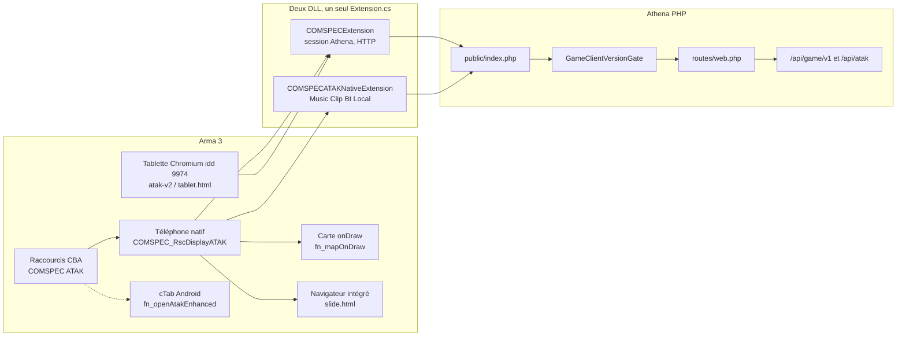

# Architecture — Arma 3, téléphone ATAK, DLL, API

Périmètre : dépôt `COMSPEC-MILSIM`, branche `release/2.7.0`, commit `e0beac95b`. Lecture seule. Aucun fichier de code modifié. Ignorés : `mergewt/`, `mod/UptoDate/_tmp*`, `mod/Workshop/`, `bin/`, `obj/`, `*.pbo` (les PBO ne sont pas ouverts ; leur présence dans le dossier d’addons est notée).

Le plancher de version LIVE (SEC-001, DLL 2.0.96 / ATAK 2.4.1) n’est pas rouvert. Il est rappelé en fin de rapport comme déjà en place.

## Verdict

Le téléphone que le joueur tient est dessiné en SQF (`COMSPEC_RscDisplayATAK`). Il ne passe pas par une page HTML. La liaison Athena du mod livré est portée par **COMSPEC Link** (`COMSPECExtension`). La DLL `COMSPECATAKNativeExtension` est le même code, compilé à part, et ne sert dans ce cas qu’au son, au presse-papiers, au Bluetooth et aux fichiers locaux. Le navigateur intégré d’Arma ne sert, sur ce téléphone, qu’aux diapositives de briefing.

Deux écarts sont confirmés sur le chemin livré (les deux PBO Overwatch sont dans `@COMSPEC_ATAK_Native`) :

- le raccourci Overwatch « Ouvrir le téléphone ATAK » ouvre cTab, ou affiche un avertissement s’il n’est pas chargé ; il n’ouvre pas le téléphone natif ;
- la copie des positions Athena déjà tenues par COMSPEC Link vers la carte du téléphone natif ne s’exécute pas, parce que le contrôle d’autorisation interroge la DLL native, qui n’a pas de session.

## Schéma

Le trait plein est le chemin du mod observé dans `mod/COMSPEC_ATAK_Native/@COMSPEC_ATAK_Native`. Les traits pointillés restent dans le code et s’ouvrent selon un réglage ou la présence de cTab.

## Ce qui est réellement chargé

Dossier d’addons observé (`mod/COMSPEC_ATAK_Native/@COMSPEC_ATAK_Native/addons`) :

| Fichier | Rôle |
| --- | --- |
| `main.pbo` | Téléphone natif, préfixe `z\comspec_atak_native\addons\main` |
| `items.pbo`, `towers.pbo` | Objets et relais |
| `comspec_overwatch_main.pbo` | Noyau Overwatch, préfixe `z\comspec_overwatch` |
| `comspec_overwatch_connect.pbo` | Liaison Athena, boucles, tablette Chromium |

DLL à côté des addons : `COMSPECExtension_x64.dll` et `COMSPECATAKNativeExtension_x64.dll`.

`atak_athena.pbo` n’est pas dans ce dossier. Les sources `mod/UptoDate/Sources/comspec-overwatch-addons/atak_athena` existent et déclarent `CfgFunctions`, avec `requiredAddons` cTab / BCE. Elles ne sont pas déclarées mortes : un autre mod peut encore les charger. Elles ne font pas partie du dossier natif observé.

Le mod SSE (`mod/@COMSPEC_SSE`) est un produit à part. `compat_atak` exige `comspec_atak_native_main` et branche le câble DL-7. Il n’est pas dans le dossier ATAK natif.

Versions lues dans les sources, pas dans les PBO :

| Repère | Valeur | Fichier |
| --- | --- | --- |
| Téléphone natif affiché | `2.7.0` / nom `2.7.0.AB - Denver` | `script_component.hpp` lignes 4-6 |
| DLL Link attendue par ce `main` | `2.0.99` | `script_component.hpp` ligne 12 |
| Les deux projets C# | `Version` et `InformationalVersion` `2.0.99` | `COMSPECExtension.csproj` ; le projet natif reprend le même `Extension.cs` avec `COMSPEC_ATAK_NATIVE` et annonce `2.0.99-native` |
| `CfgPatches` du téléphone | `version=1.8` alors que `versionStr=VERSION_STR` | `config.cpp` ligne 7 |
| Connect | `versionStr` `1.6.21` | `connect/config.cpp` lignes 21-23 |
| Overwatch main | `versionStr` `1.4.8` | `main/config.cpp` lignes 9-11 |
| Couche cTab | `versionStr` `1.0.168` | `atak_athena/config.cpp` lignes 19-21 |

`/api/atak/version` lit `VERSION_STR` et l’`InformationalVersion` du projet Link (`AtakReleaseInfo.php` lignes 18-19, 39-41). Ce n’est pas le champ numérique `version=1.8`.

## Deux DLL, une session

`COMSPECATAKNativeExtension.csproj` compile `Extension.cs` et les fichiers partiels du dossier Link, plus la constante `COMSPEC_ATAK_NATIVE`. Les noms produit divergent (`Extension.cs` lignes 18-28) :

- sans la constante : produit `COMSPECExtension`, génération d’interface `legacy-mixed` ;
- avec la constante : produit `COMSPECATAKNativeExtension`, génération `native-rsc-v1`.

Le numéro envoyé dans le User-Agent est la constante `ExtensionVersion = "2.0.99"` (`Extension.cs` ligne 48), posée sur chaque requête (`Extension.cs` lignes 154-155 et 3251-3252).

Points d’entrée natifs, les deux builds : `RVExtensionVersion`, `RVExtension`, `RVExtensionArgs`, `RVExtensionRegisterCallback` (`Extension.cs` lignes 429, 2816, 2855, 2956). Le rappel s’appelle `comspec` pour les deux DLL (ligne 450). Le téléphone et COMSPEC Link ont chacun un gestionnaire `ExtensionCallback`. Les tickets `async:` sont rangés dans deux tables distinctes (`COMSPEC_ATAK_ExtPending` et `COMSPEC_ExtPending`).

`fn_bridge.sqf` est vrai dès que `comspec_overwatch_connect_fnc_isReady` existe, donc dès que le PBO connect est chargé. Dans ce cas, `XEH_postInitClient.sqf` lignes 27-28 n’appelle ni `Init` ni `RestoreSession` sur la DLL native. La session HTTP reste dans COMSPEC Link.

Commandes présentes seulement dans la DLL native (`Extension.cs` lignes 3547-3567, fichiers du projet natif compilés par le SDK) : `Music*`, `Clip*`, `Bt*`, `Local*`. Le SQF les envoie toujours à `COMSPECATAKNativeExtension` via `fn_extensionCall.sqf` ligne 4. Musique, presse-papiers, Bluetooth et JSON local fonctionnent même quand la session Athena est sur Link.

`fn_extAwait.sqf` enveloppe `Async` pour ne pas bloquer le fil du jeu. Sans rappel enregistré, il retombe sur `callExtension` direct.

## Téléphone natif

Ouverture : `fn_open.sqf`. En main, `createDisplay "COMSPEC_RscDisplayATAK"` (ligne 25). Porté, calque HUD `COMSPEC_RscTitleATAK` (ligne 51), ou écran 3D du gilet (`fn_jpcScreen`). `displays.hpp` lignes 6-9 : `onLoad` → `fn_displayLoad`, `onUnload` → `fn_displayUnload`.

`fn_displayLoad.sqf` ligne 129 démarre `fn_schedulerTick` toutes les 0,2 s (`fn_schedulerStart.sqf` ligne 3). Tant que l’écran existe : unités et marqueurs locaux (carte et BFT jusqu’à 4 fois par seconde en main), barre d’état chaque seconde, `fn_remoteSync` selon `COMSPEC_ATAK_BftRefresh` (défaut 3 s), pouls de la file Link toutes les 5 s.

Fermeture : `fn_close.sqf` ferme le display ou le HUD. `fn_displayUnload.sqf` arrête le scheduler, la vidéo live, la vue JPC, et rend le menu d’actions. Si le joueur avait le téléphone en main et que la miniature était voulue, la frame suivante rappelle `fn_open` en HUD (lignes 44-46). Fermer l’écran ne déconnecte pas Athena.

Routage des apps : `fn_navigate.sqf` puis `fn_pageRender.sqf` (lignes 61-123). Les apps dont le nom de page n’est pas dans le `switch` (Galerie, Itinéraire, Garmin, etc.) sont dessinées par le champ `function` de `COMSPEC_ATAK_Apps` (`config.cpp` lignes 122-186). Une classe `wip=1` (Brèche, OSINT) est affichée grisée et ne s’ouvre pas (`fn_navigate.sqf` lignes 5-9).

### Carte

Trois contrôles carte dans le display (`displays.hpp` lignes 22-25), un seul visible (`fn_mapCtrl`). Chaque image : `onDraw` appelle `fn_mapOnDraw`, qui enchaîne relief, maillage radio, logistique, guerre électronique, drone, traits, symboles. Les données locales viennent de `fn_localDataRefresh` (unités de la mission, marqueurs Arma). Les positions « Athena sans objet en jeu » viennent de la clé `remoteUnits`, remplie seulement par `fn_pollUnits`.

### Drone

`fn_pageDrone` dessine la page et demande la texture à `fn_droneAction` (`camBind`). La nacelle tourne dans un gestionnaire permanent. Si la page n’est plus Drone, ni une vue drone sur la carte, ni la vue plein écran : le rendu s’arrête au bout de 1,5 s, la caméra est détruite au bout de 5 s (`fn_droneAction.sqf` lignes 371-387 et 1302-1306, cas `camPark`). La vue plein écran (`direct`) continue téléphone rangé ; Échap, mort ou perte de liaison la coupe (commentaire lignes 1320-1323). Fermer le téléphone n’envoie pas `release` au drone : il garde son ordre.

### Galerie

`fn_pageGallery` liste les fichiers du téléphone (`fn_photoLibrary`) et les clichés drone du profil (`COMSPEC_ATAK_DronePhotos`). L’état d’envoi est lu dans les variables Link `COMSPEC_Athena_PhotoUploaded`, `PhotoFailed`, `PhotoPending`. La suppression d’un fichier appelle `DeleteLocalFile` sur le nom `COMSPECExtension` (`fn_photoLibrary.sqf` lignes 98 et 108). Pas de page HTML.

### Briefing et navigateur intégré

Seul usage WebView du téléphone natif : `fn_slideWebShow.sqf` charge `z\comspec_atak_native\addons\main\data\web\slide.html` (ligne 30) puis pousse l’image en JavaScript. Repli `data:` au bout de 4 s (lignes 32-42). Le téléchargement de l’image passe par `DownloadBriefingSlideImage` / `ImageDataChunk` sur `COMSPECExtension` (`fn_pageBriefing.sqf` lignes 304 et 335), et le décodage du retour utilise `comspec_overwatch_connect_fnc_extResult`.

### Déconnexion Athena

COMSPEC Link : `fn_disconnect.sqf` envoie `Disconnect` à `COMSPECExtension` une fois (`COMSPEC_DisconnectSent`). Branché sur la fin de mission et sur la fermeture de l’écran de jeu 46 (`connect/XEH_postInit.sqf` lignes 691-726). Le téléphone natif n’a pas d’appel équivalent. Sans le PBO connect, la fin de partie ne poste pas `/api/atak/disconnect` ; le portail expire la liaison par son propre délai (commentaire lignes 691-693).

## COMSPEC Link et l’ancienne tablette

Réglage `comspec_overwatch_atak_ui_only`, coché par défaut (`connect/XEH_preInit.sqf` lignes 364-370).

- Coché : le raccourci « Ouvrir le téléphone ATAK » appelle `fn_openAtakEnhanced` (lignes 713-714).
- Décoché : `fn_webBrowserShow` ouvre `COMSPEC_WebBrowser_Dialog`, idd 9974.

`fn_openAtakEnhanced.sqf` lignes 13-26 n’appelle que `cTab_fnc_onIfMainPressed` ou `cTab_fnc_open`. Si cTab est absent, le joueur voit « Le téléphone tactique ATAK n’est pas disponible ». Aucun repli vers `comspec_atak_native_fnc_open`. Le téléphone natif a ses propres raccourcis, catégorie « COMSPEC ATAK » (`XEH_postInitClient.sqf` lignes 49-58, touche principale Ctrl+U / `0x16`).

La tablette Chromium charge `atak-v2.html` ou `tablet.html` selon `COMSPEC_TabletUiVersion` (`fn_webBrowserOnLoad.sqf` lignes 146-159). Le JavaScript parle au jeu par `alert("COMSPEC|…")` (`app.js` lignes 9-15), lu par `fn_webBrowserJSDialog.sqf`. Ces fichiers restent joignables tant que le réglage est décoché. Ils ne sont pas morts.

Après liaison, `fn_startSyncLoops.sqf` arme les boucles (position, marqueurs, ordres, tchat) sur COMSPEC Link. Le téléphone natif est censé lire cette liste au lieu d’ouvrir une seconde session (`fn_pollUnits.sqf` lignes 1 et 15-20 ; `fn_pollMarkers.sqf`, `fn_pollOrders.sqf` et `fn_pollChat.sqf` sortent tout de suite si Link est là).

## API PHP

`public/index.php` charge l’application, sert les fichiers sous `/assets/` et `/uploads/`, puis applique `GameClientVersionGate::check` (lignes 191-203) avant la maintenance et le routeur. `routes/web.php` est exigé (lignes 287-296). Le routeur garde la première route qui correspond (`Router.php` lignes 80-84).

Session de jeu : `/api/game/v1/auth/*`, `/api/game/v1/session/*`, bootstrap, profil, config (lignes 2498-2515). Exploitation ATAK : à partir de `/api/atak/whoami` (ligne 2517), sondages et envois (présence, tchat, marqueurs, photos, musique, ordres, etc.). Publics sans session : `/api/atak/ping`, `/api/atak/version`, `/api/atak/startup-check`. Le User-Agent des DLL est `COMSPECExtension/2.0.99` ou `COMSPECATAKNativeExtension/2.0.99`.

## Problèmes

### ARCH-001 — Le raccourci Overwatch n’ouvre pas le téléphone natif

- **Statut :** confirmé
- **Fichier :** `mod/UptoDate/Sources/comspec-overwatch-addons/connect/functions/fn_openAtakEnhanced.sqf:13-26`, appelé depuis `connect/XEH_preInit.sqf:713-714`
- **Symptôme :** avec « Tout passe par le téléphone ATAK » coché (défaut), le raccourci dont le libellé est « Ouvrir le téléphone ATAK » ouvre cTab, ou affiche que le téléphone ATAK n’est pas disponible.
- **Cause :** `fn_openAtakEnhanced` ne connaît que `cTab_fnc_onIfMainPressed` et `cTab_fnc_open`. Le dossier d’addons observé ne contient pas cTab. Le téléphone natif s’ouvre par d’autres raccourcis (`fn_open.sqf`).
- **Preuve :** le fichier entier de `fn_openAtakEnhanced` ne cite pas `comspec_atak_native_fnc_open`. `requiredAddons` du `main` natif (`config.cpp` ligne 5) ne liste pas cTab. Les cinq PBO du dossier natif ne contiennent pas la couche `atak_athena`.
- **Gravité :** haute pour quiconque utilise le raccourci Overwatch.
- **Impact :** sans cTab, le raccourci ne montre pas le téléphone 2.7.0. Avec cTab, il ouvre l’autre téléphone. Briefing, fiches et médical passent déjà par `fn_openNativePage.sqf`, qui ouvre bien le natif si le patch est là.
- **Correction proposée :** si `comspec_atak_native_main` est chargé, faire ouvrir `comspec_atak_native_fnc_open` (et la page demandée) avant cTab. Garder cTab seulement en secours.
- **Validation :** sans cTab, le raccourci Overwatch affiche le téléphone natif. Avec cTab et le patch natif, le même raccourci affiche encore le natif. Décocher le réglage ouvre toujours la tablette idd 9974.

### ARCH-002 — Les positions Athena de Link ne sont pas recopiées sur la carte native

- **Statut :** confirmé
- **Fichier :** `mod/COMSPEC_ATAK_Native/Sources/addons/main/functions/network/fn_remoteSync.sqf:6-9`, puis `fn_pollUnits.sqf:15-20` ; initialisation sautée dans `XEH_postInitClient.sqf:27-28`
- **Symptôme :** dès que COMSPEC Link est chargé, la liste d’effectifs qu’il tient n’est jamais écrite dans `remoteUnits`. La carte native ne montre donc pas les positions Athena « sans objet dans la mission ».
- **Cause :** `fn_remoteSync` demande `GetAuthState` à `COMSPECATAKNativeExtension` (`fn_extensionCall.sqf:4`) et sort si la réponse ne contient pas `READY`. Avec Link, cette DLL n’a pas reçu `Init` ni `RestoreSession`. Son état par défaut est `INITIALIZING` (`GameAuth.cs:13`). `fn_pollUnits`, qui sait copier `comspec_overwatch_connect_fnc_getUnitsList`, n’est pas atteint. `fn_schedulerTick.sqf:21` est le seul appel périodique de `fn_remoteSync`.
- **Preuve :** `fn_pollMarkers.sqf:2`, `fn_pollOrders.sqf:2` et `fn_pollChat.sqf:2` sortent volontairement si Link est là. Seule la branche unités était prévue pour recopier Link, et le garde-fou d’avant l’empêche. `fn_localDataRefresh.sqf:16` lit `remoteUnits` et ne les remplit pas.
- **Gravité :** haute pour le suivi des opérateurs connus d’Athena mais absents comme objets locaux. Les coéquipiers présents dans la mission restent dessinés par le relevé local.
- **Impact :** le téléphone et le site ne montrent pas la même liste d’effectifs distants, alors que Link a déjà les données.
- **Correction proposée :** si `fn_bridge` est vrai, ne pas exiger `READY` sur la DLL native ; appeler `fn_pollUnits` dès que Link est prêt (`COMSPEC_AthenaReady` ou l’état d’auth Overwatch). Laisser le contrôle `GetAuthState` natif au mode sans Link.
- **Validation :** avec les deux PBO, après liaison, un opérateur présent seulement dans la liste Link apparaît dans `remoteUnits` et sur la carte en filtre « tous ». Sans Link, `remoteSync` attend toujours `READY` sur la DLL native.

### ARCH-003 — L’état de session natif est découpé sur le mauvais séparateur

- **Statut :** confirmé sur le mode sans COMSPEC Link. Avec Link, l’écran Athena lit les variables Overwatch (`fn_athenaStatus.sqf:21-28`), pas cette découpe.
- **Fichier :** `GameAuth.cs:183` (`string.Join("\t", …)`) ; `fn_athenaStatus.sqf:30` et `fn_statusUpdate.sqf:98` (`splitString "|"`).
- **Symptôme :** sans Link, l’app Athena et le bandeau « non connecté » ne voient pas l’état `READY`, même si la DLL native l’est.
- **Cause :** `FormatGameAuthState` joint les cellules par tabulation, pour que `splitString` d’Arma ne mange pas les vides (commentaire lignes 181-182). Le SQF natif découpe sur `|`. La chaîne tient dans la première cellule ; l’index 1 est vide. `fn_remoteSync` cherche le mot `READY` dans le texte brut, donc ce n’est pas le même bug qu’ARCH-002.
- **Preuve :** `connect/functions/auth/fn_authStateCells.sqf` documente la découpe tabulation pour le même appel. Le natif ne reprend pas cette fonction.
- **Gravité :** moyenne, limitée au jeu sans PBO connect.
- **Impact :** compte Athena ouvert sur la DLL native, l’écran peut rester sur « non connecté » et relancer le bandeau toutes les 10 minutes (`fn_statusUpdate.sqf:120-125`).
- **Correction proposée :** découper `GetAuthState` comme `fn_authStateCells` (tabulation, cellules vides conservées), dans `fn_athenaStatus` et `fn_statusUpdate`.
- **Validation :** sans Link, après `RestoreSession` réussi, l’app Athena affiche l’état connecté et le bandeau ne revient pas.

### ARCH-004 — Beaucoup d’apps natives appellent COMSPEC Link par son nom, même sans lui

- **Statut :** confirmé dans le source. Le dossier livré contient le PBO connect, donc le chemin habituel trouve la DLL. L’écart apparaît si l’on charge le téléphone sans ce PBO.
- **Fichiers :** entre autres `fn_pageBriefing.sqf:304`, `fn_photoLibrary.sqf:98`, `fn_frsSubmit.sqf:114`, `fn_squadSync.sqf:28`, `fn_screenTime.sqf:103`, `fn_planWeb.sqf:87`, `fn_discordAction.sqf:40`, `XEH_postInitServer.sqf:198`. Le choix selon `fn_bridge` existe dans `fn_athenaAction.sqf:29`, `fn_athenaLink.sqf:67` et `fn_extVersion.sqf:10`, pas dans ces appels.
- **Symptôme :** sans COMSPEC Link, briefing, galerie (suppression et photos connues), fiches, escouade, temps d’écran, plan et Discord s’adressent à une extension absente. La session, si elle existe, est sur `COMSPECATAKNativeExtension` (`XEH_postInitClient.sqf:36-38`), avec l’adresse fixe `https://athena-comspec.eu/public`.
- **Cause :** le nom `COMSPECExtension` est écrit en dur. `fn_extensionCall` ne sert que les commandes locales.
- **Preuve :** recherche `callExtension` / `extAwait` dans `Sources/addons/main` : la majorité des commandes HTTP citent `COMSPECExtension` sans tester `fn_bridge`.
- **Gravité :** moyenne tant que le mod livré embarque connect ; haute si une mission ne charge que `main.pbo`.
- **Impact :** mode « téléphone seul » annoncé par le `postInit` (session native) : les apps qui parlent à Athena ne parlent pas à la DLL qui a la session. Le serveur dédié sonde `ScreenTime.Batch` sur Link même si seule la DLL native est là.
- **Correction proposée :** une fonction unique « extension de session » qui renvoie `COMSPECExtension` ou `COMSPECATAKNativeExtension` selon `fn_bridge`, et l’utiliser pour tout appel HTTP. Garder `fn_extensionCall` pour Music, Clip, Bt et Local.
- **Validation :** sans PBO connect, une fiche ou une photo part vers Athena avec le User-Agent `COMSPECATAKNativeExtension/2.0.99` et la session restaurée. Avec connect, le User-Agent reste `COMSPECExtension/2.0.99`.

### ARCH-005 — Trois interfaces téléphone restent joignables

- **Statut :** confirmé pour le natif et pour la tablette Chromium (code du PBO connect). cTab n’est joignable que si un autre mod le charge. `atak_athena` n’est pas dans le dossier d’addons observé.
- **Fichiers :** `fn_open.sqf:25` (natif) ; `fn_webBrowserShow.sqf:1-29` et `fn_webBrowserOnLoad.sqf:154-159` (idd 9974, `atak-v2.html` ou `tablet.html`) ; `fn_openAtakEnhanced.sqf:13-21` (cTab). Réglage : `XEH_preInit.sqf:364-370`.
- **Symptôme :** selon le réglage et les mods, le joueur peut obtenir le téléphone SQF, la tablette HTML, ou cTab. Les trois parlent à la même DLL de liaison quand elle est là.
- **Cause :** l’ancienne tablette et le pont cTab n’ont pas été retirés quand le téléphone natif est devenu l’interface. Le réglage « tout passe par le téléphone ATAK » pointe encore vers cTab (ARCH-001), pas vers le natif.
- **Preuve :** `COMSPEC_TabletUiVersion` choisit encore v1 ou v2. `app.js` envoie encore `COMSPEC|`. Le HTML `slide.html` du natif est un autre fichier, limité aux diapositives.
- **Gravité :** moyenne. Le défaut joueur du téléphone 2.7 est le display natif, via ses propres touches.
- **Impact :** deux cartes, deux messageries et deux chemins de marqueurs à maintenir. Une correction faite seulement dans le HTML ne se voit pas sur le téléphone natif, et l’inverse.
- **Correction proposée :** après ARCH-001, laisser la tablette Chromium derrière le réglage décoché, documentée comme ancienne interface. Ne pas y ajouter de fonction joueur. Ne pas supprimer `atak-v2` tant que le réglage existe.
- **Validation :** réglage coché, sans cTab : téléphone natif. Réglage décoché : idd 9974 et `atak-v2.html` ou `tablet.html`. Diapositive de briefing : toujours `slide.html` dans le téléphone natif.

### ARCH-006 — Routes d’administration enregistrées deux fois

- **Statut :** confirmé, sans effet observable
- **Fichier :** `routes/web.php:1978-1979` et `1989-1990` (`GET` et `DELETE` `/api/atak/relays/{mapId}/{uid}`) ; `1984` et `1987` (`POST` `/api/atak/roleplay/server-tests`) ; `1977` et `1988` (page relais).
- **Symptôme :** aucun, tant que les deux enregistrements visent le même contrôleur.
- **Cause :** le bloc relais / roleplay est collé deux fois. `Router::dispatch` s’arrête à la première route qui correspond (`Router.php:80-84`). La seconde n’est jamais appelée.
- **Preuve :** les paires citent les mêmes classes et les mêmes méthodes (`AdminAtakRelaysController::show/delete`, `AdminAtakRoleplayController::serverTests`).
- **Gravité :** facultative.
- **Impact :** la prochaine édition qui ne changerait qu’une des deux copies serait ignorée.
- **Correction proposée :** retirer le second bloc (lignes 1987-1990), après avoir vérifié qu’aucune des deux copies n’a divergé.
- **Validation :** `GET` et `DELETE` relais, et le test serveur roleplay, répondent comme avant.

### ARCH-007 — Le numéro de patch du téléphone natif est resté à 1.8

- **Statut :** confirmé comme incohérence de métadonnée. Pas une preuve que le jeu affiche 1.8 au joueur : `versionStr` vaut `2.7.0`.
- **Fichier :** `mod/COMSPEC_ATAK_Native/Sources/addons/main/config.cpp:7` (`version=1.8; versionStr=VERSION_STR`) et `script_component.hpp:5`.
- **Symptôme :** un outil qui lit le nombre `version` de `CfgPatches` voit 1.8, pas 2.7.0.
- **Cause :** `version` a été laissé en littéral pendant que `VERSION_STR` montait.
- **Preuve :** les deux lignes. `/api/atak/version` lit `VERSION_STR`, pas ce nombre (`AtakReleaseInfo.php:39`).
- **Gravité :** facultative.
- **Impact :** diagnostic et lanceur peuvent citer deux numéros pour le même PBO. Connect (`1.6.21`) et Overwatch main (`1.4.8`) ont le même décalage historique vis-à-vis du 2.7.0, sans que ces chiffres pilotent le plancher DLL.
- **Correction proposée :** aligner `version` sur la version produit, ou cesser de le lire. Ne pas confondre avec `LINK_VERSION_STR`.
- **Validation :** `configName` / `versionStr` du patch `comspec_atak_native_main` et le nombre `version` racontent la même version.

## Fichiers non déclarés morts

Aucun fichier n’est déclaré mort. Preuves du contraire, ou absence de preuve :

- `connect/web/atak-v2/*` et `tablet.html` : chargés par `fn_webBrowserOnLoad.sqf:154-159` si la tablette s’ouvre.
- `pause_manager.html` : chemin propre, commentaire de `fn_pauseManagerShow.sqf`.
- `data/web/slide.html` : `fn_slideWebShow.sqf:30`.
- `LocalConfig.cs`, `Clipboard.cs`, `BtTransfer.cs`, `MusicPlayer.cs` : classes partielles `Extension`, appelées sous `COMSPEC_ATAK_NATIVE` (`Extension.cs:3547-3567`). Le SDK compile les `.cs` du projet natif en plus des `Compile Include`.
- `atak_athena` : `CfgFunctions` et appels depuis connect (`fn_athena_openFeature` et voisins). Absent du dossier d’addons observé, pas injoignable si un autre PBO est chargé.
- `mod/Overwatch 2026/` : hors du dossier natif observé. Pas d’audit de chaque `execVM` de cette archive ; elle n’est pas le mod livré dans `@COMSPEC_ATAK_Native`.

## Plancher de version — non rouvert

Contrôle unique : `GameClientVersionGate`, appelé dans `public/index.php` avant la session et la base. User-Agent `COMSPECExtension/<version>` ou `COMSPECATAKNativeExtension/<version>`. `/api/atak/version` est exempté (`GameClientVersionGate.php` lignes 57-58) et annonce `atak_native` / `link` depuis les sources (`AtakVersionController.php`).

Constat déjà vérifié le 2026-10-27, non retesté ici et non traité comme un trou ouvert : `COMSPECExtension/2.0.95` et `COMSPECATAKNativeExtension/1.0.0-native` reçoivent HTTP 403 `MOD_OUTDATED` ; `COMSPECExtension/2.0.99` et un navigateur reçoivent 401 (le plancher les laisse passer) ; `/api/atak/version` reste ouvert et annonce `atak_native` 2.7.0 / `link` 2.0.99.

Le second argument `1.0.0-native` de `RestoreSession` (`XEH_postInitClient.sqf:38`) est la version de mod envoyée à la reprise, pas le User-Agent. Le User-Agent vient de `ExtensionVersion` (`2.0.99`). Ce n’est pas un contournement du plancher DLL.

## Points d’entrée

Arma / SQF

- `mod/COMSPEC_ATAK_Native/Sources/addons/main/config.cpp` — `CfgPatches`, `CfgFunctions` (`comspec_atak_native`), `COMSPEC_ATAK_Apps`
- `mod/COMSPEC_ATAK_Native/Sources/addons/main/ui/displays.hpp` — `COMSPEC_RscDisplayATAK` (`onLoad` / `onUnload` / `onDraw`)
- `mod/COMSPEC_ATAK_Native/Sources/addons/main/functions/ui/fn_open.sqf` — ouverture du téléphone
- `mod/COMSPEC_ATAK_Native/Sources/addons/main/XEH_postInitClient.sqf` — raccourcis, rappel `ExtensionCallback`, session native si Link est absent
- `mod/UptoDate/Sources/comspec-overwatch-addons/connect/config.cpp` — `CfgFunctions` (`comspec_overwatch_connect`)
- `mod/UptoDate/Sources/comspec-overwatch-addons/connect/XEH_preInit.sqf` — raccourcis Overwatch, réglage `comspec_overwatch_atak_ui_only`
- `mod/UptoDate/Sources/comspec-overwatch-addons/connect/functions/fn_openAtakEnhanced.sqf` — cTab
- `mod/UptoDate/Sources/comspec-overwatch-addons/connect/functions/fn_webBrowserShow.sqf` — tablette idd 9974
- `mod/UptoDate/Sources/comspec-overwatch-addons/connect/functions/fn_connect.sqf` et `fn_startSyncLoops.sqf` — liaison et boucles
- `mod/UptoDate/Sources/comspec-overwatch-addons/connect/functions/fn_disconnect.sqf` — fin de liaison
- `mod/UptoDate/Sources/comspec-overwatch-addons/atak_athena/config.cpp` — couche cTab, absente du dossier d’addons observé
- `mod/UptoDate/Sources/comspec-overwatch-addons/main/config.cpp` — `CfgMods` COMSPEC Overwatch
- `mod/@COMSPEC_SSE/addons/compat_atak/config.cpp` — pont SSE, si le mod SSE est chargé

DLL

- `mod/UptoDate/COMSPECExtension/Extension.cs` — `RVExtension`, `RVExtensionArgs`, `RVExtensionVersion`, `RVExtensionRegisterCallback`
- `mod/UptoDate/COMSPECExtension/GameAuth.cs` — `Init`, `RestoreSession`, `GetAuthState`, authentification jeu
- `mod/COMSPEC_ATAK_Native/COMSPECATAKNativeExtension/COMSPECATAKNativeExtension.csproj` — second build, `COMSPEC_ATAK_NATIVE`
- `LocalConfig.cs`, `Clipboard.cs`, `BtTransfer.cs`, `MusicPlayer.cs` — commandes locales du build natif

WebView

- `mod/COMSPEC_ATAK_Native/Sources/addons/main/data/web/slide.html` — diapositive dans le téléphone
- `mod/COMSPEC_ATAK_Native/Sources/addons/main/functions/pages/fn_slideWebShow.sqf`
- `mod/UptoDate/Sources/comspec-overwatch-addons/connect/web/atak-v2/atak-v2.html` et `app.js` — tablette v2
- `mod/UptoDate/Sources/comspec-overwatch-addons/connect/web/tablet.html` — tablette v1
- `mod/UptoDate/Sources/comspec-overwatch-addons/connect/functions/fn_webBrowserJSDialog.sqf` — pont `COMSPEC|`

PHP

- `public/index.php` — front, fichiers statiques, plancher DLL, puis routeur
- `routes/web.php` — `/api/game/v1/*`, `/api/atak/*`
- `app/Core/Router.php` — première route gagnante
- `app/Support/GameClientVersionGate.php` — plancher User-Agent
- `app/Controllers/Api/AtakVersionController.php` — `GET /api/atak/version`
- `app/Controllers/Api/Game/GameAuthApiController.php` — session de jeu
- `app/Controllers/Api/AtakApiController.php` — sondages et envois ATAK

---

## Append — follow-up ARCH-006

Doublons `/api/atak/roleplay/server-tests` et second bloc `relays-network` / `api/atak/relays` retires. Redirects `/admin/atak/roleplay` conserves.
